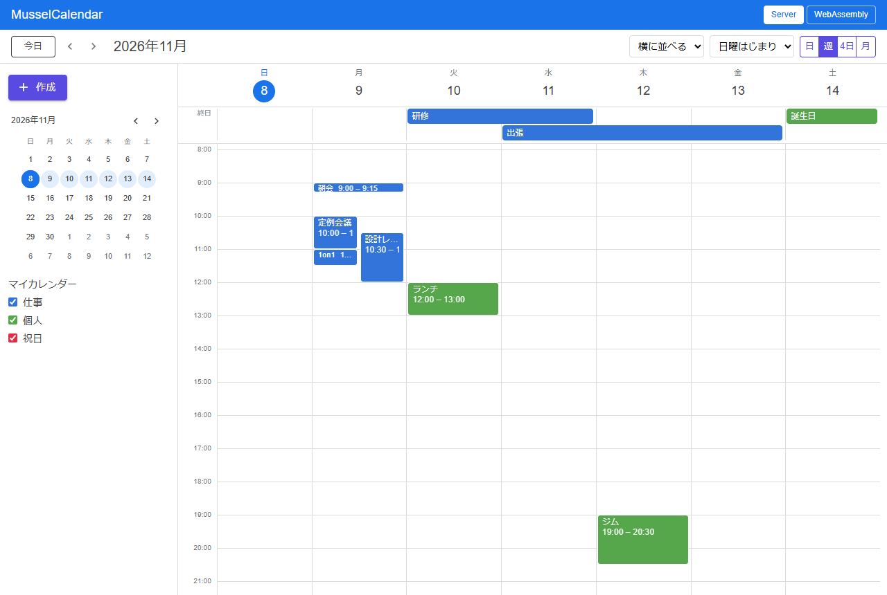
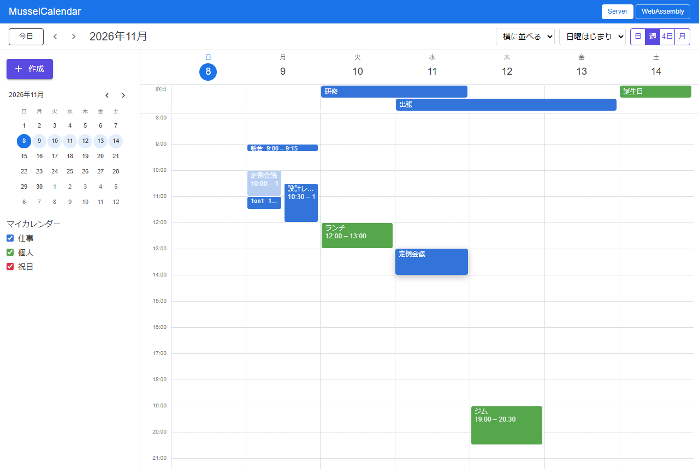
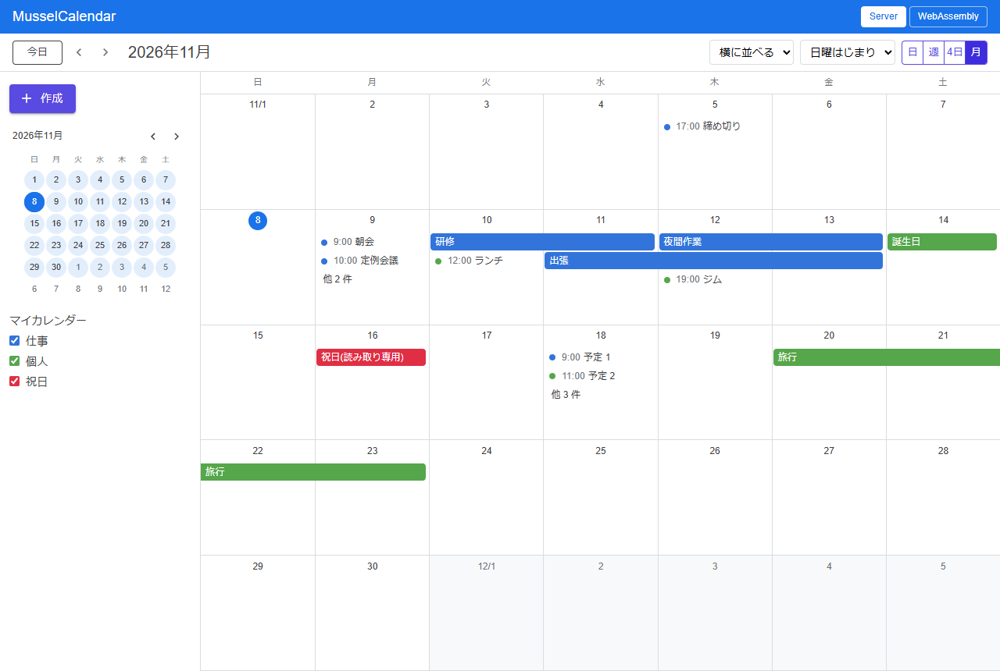

# MusselCalendar - Calendar for Blazor

[](https://www.nuget.org/packages/MusselCalendar/)

## 🐚 What is this?

Day, week and month calendar views for Blazor, made for apps that keep schedules.  
Items are selected, moved and resized with a mouse, touch or the keyboard; the view reports each change, and the application keeps the data. A sibling of [MusselChart](https://github.com/usausa/mussel-chart).  

| 🗓️ Week | 🖱️ Drag | 📆 Month |
|:-:|:-:|:-:|
|  |  |  |

## 🚀 Quick Start

Link the stylesheet in the page head.  

```html
<link rel="stylesheet" href="_content/MusselCalendar/MusselCalendar.css" />
```

Show the items in an interactive component, and apply the changes the view reports. The view fills the height of its parent.  

```razor
@page "/"
@using MusselCalendar

<div style="height: 640px">
    <MusselCalendarView Date="date" Items="items" RangeSelected="OnRangeSelected" ItemChanged="OnItemChanged" />
</div>

@code {
    private readonly List<CalendarItem> items =
    [
        new() { Id = "1", Title = "Meeting", Start = DateTime.Today.AddHours(10), End = DateTime.Today.AddHours(11) },
        new() { Id = "2", Title = "Trip", Start = DateTime.Today, End = DateTime.Today.AddDays(2), AllDay = true }
    ];

    private DateOnly date = DateOnly.FromDateTime(DateTime.Today);

    private void OnRangeSelected(CalendarSelectEventArgs e) =>
        items.Add(new CalendarItem { Id = Guid.NewGuid().ToString(), Title = "New event", Start = e.Start, End = e.End, AllDay = e.AllDay });

    private static void OnItemChanged(CalendarItemChangeEventArgs e)
    {
        e.Item.Start = e.Start;
        e.Item.End = e.End;
        e.Item.AllDay = e.AllDay;
    }
}
```

`View` switches the day, week, N days and month views, `CalendarRange.Move` gives the date of the next page, and `MusselMiniMonth` picks a date.  

```razor
<MusselMiniMonth @bind-Date="date" FirstDayOfWeek="DayOfWeek.Monday" Highlight="CalendarRange.Of(view, date, DayOfWeek.Monday, 4)" />

<MusselCalendarView View="view" Date="date" FirstDayOfWeek="DayOfWeek.Monday" Items="items" />
```

The `Example` project shows a calendar page with popups on Server and WebAssembly.  

## 🎨 Look

| Part | Detail |
|---|---|
| Theme | CSS variables shared with MusselChart (`--mussel-primary-text`, `--mussel-muted-text`, `--mussel-grid-line`), and `--mussel-calendar-*` for the calendar |
| Items | `Color` of each item; timed items of one day are a dot and a time in the month view |
| Overlaps | Side by side (`Columns`) or stacked with an offset (`Stack`) |
| Sizes | `HourHeight`, `MonthLanes`, `--mussel-calendar-gutter` and `--mussel-calendar-lane-height` |

## ✅ Supported features

| Category | Detail |
|---|---|
| **Views** | Day, week, N days and month, any first day of the week, and a mini month that marks the shown range |
| **Items** | Timed and all-day items, items over several days or midnight, read-only items, overlaps, hidden counts in month cells and the current time line |
| **Mouse and touch** | Click or drag to select a range, drag to move or resize, moving between the all-day lane and the time grid, auto scroll, Esc to cancel, and a long press to start a drag on touch |
| **Keyboard** | Enter or Space opens an item, Alt+arrow keys move it, and Alt+Shift+Up or Down change its end |
| **Hosting** | Interactive Server and WebAssembly |

The view shows `CalendarItem`s in local time and reports what the user did; saving, repeat rules, time zones and reminders belong to the application.  

## 📖 API

See the [API reference](Document/API.md).  

## 🌊 Mussel family

- [MusselChart](https://github.com/usausa/mussel-chart) - Charts
- [MusselSheet](https://github.com/usausa/mussel-sheet) - Input sheet
- [MusselCalendar](https://github.com/usausa/mussel-calendar) - Calendar
